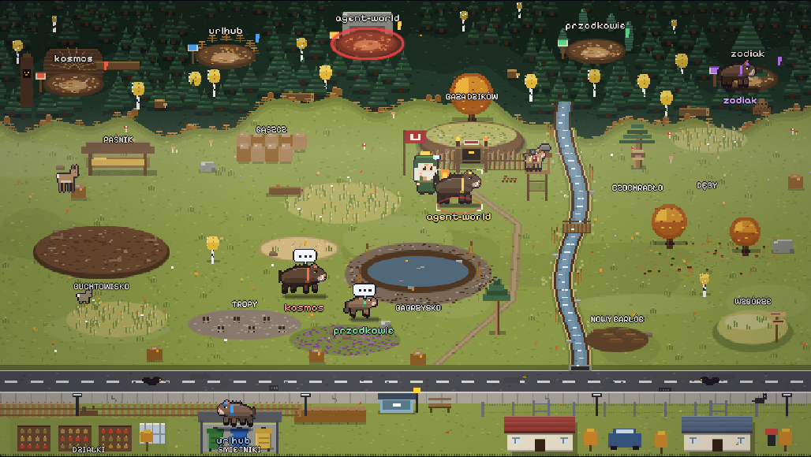

# Agent World: your Claude Code sessions as a pack of wild boars

A live pixel-art map of your Claude Code sessions. Each session is a wild boar with a den named after its project,
each subagent a piglet, each tool a feeding spot. When Claude needs your permission, its boar comes to your camp
with a red “!”. Seasons and the time of day follow the clock.



- **Try it hosted:** https://dziki.doner.cloud/start/ (log in with a one-time email code; a free guest account for
  24 hours; the interface is in Polish for now)
- **Host it yourself:** Node and `curl`, no dependencies. MIT licence.

## How it works

```
hooks/emit.sh              Claude Code hook: forwards each event to the collector
hooks/settings.hooks.json  the hooks to add to ~/.claude/settings.json
hooks/podlacz.sh           one-line connect script for a remote computer (token + data mode)
collector/server.js        takes the events, keeps the state (~/.agent-world/state.json), SSE /stream, serves web/
web/                       the pixel world: engine.js, forest-map.js (terrain, seasons), forest-life.js (boars), live.js (SSE)
docs/concepts/             a mock-up with simulated sessions, the same engine without live data
docs/hook-events.md        the hook events Claude Code sends and how they map to states
```

Statuses: `idle` → `thinking` (after a prompt) → `tool` (running a tool) → `waiting_for_user` (permission request or
idle) → `done` (session ended); `error` when a turn failed on an API error. Subagents are entries with a `parentId`.

## Run it on your own server

```bash
git clone https://github.com/adahyto/agent-world ~/agent-world
chmod +x ~/agent-world/hooks/emit.sh
# add the "hooks" key of hooks/settings.hooks.json to ~/.claude/settings.json (keep a backup), then:
node ~/agent-world/collector/server.js        # listens on 127.0.0.1:7777
ssh -L 7777:127.0.0.1:7777 you@your-server    # then open http://localhost:7777
```

As a service, `~/.config/systemd/user/agent-world.service`:

```ini
[Unit]
Description=Agent World collector

[Service]
ExecStart=/usr/bin/env node %h/agent-world/collector/server.js
Restart=always

[Install]
WantedBy=default.target
```

```bash
systemctl --user daemon-reload && systemctl --user enable --now agent-world
loginctl enable-linger $USER
```

**Do not expose the collector without authentication:** events contain prompts and parts of replies. The hosted
version sits behind Cloudflare Access (`AGENT_WORLD_ACCESS_TEAM`, `AGENT_WORLD_ACCESS_AUD`); remote computers post to
`/ingest` with a token of their own, choosing `status` (states and tool names) or `full` (also prompts and replies).

## API

- `GET /agents`: the agents (`id, name, status, waitingFor, currentTool, lastMessage, parentId, kind, toolCalls, updatedAt`)
- `GET /events?since=<ts>`: normalised events
- `GET /stream`: SSE, first `{type:'snapshot', agents}`, then `{type:'event', event, agents}` on each change
- `GET /`: the pixel world; `GET /table`: a plain table. An account with no sessions and no connected computer sees a demo (made-up boars, marked as such) until its first session or token

There is no raw event log by default (events contain prompts, tool results and whole files read):
`touch ~/.agent-world/raw-log.on` turns it on, writing `~/.agent-world/events.jsonl`.

Polish notes and the original setup guide: [README.pl.md](README.pl.md).

Made by [doner.cloud](https://doner.cloud/). Not affiliated with Anthropic.
